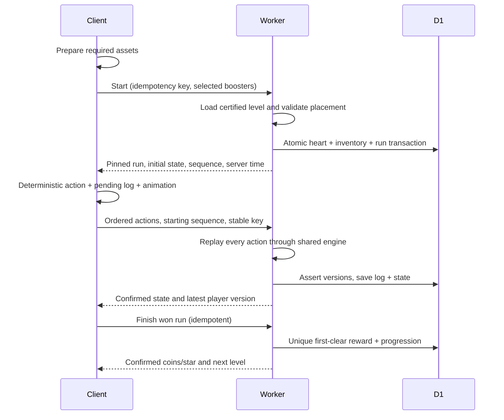

# Architecture

## Runtime ownership

React owns boot, navigation, accessible interactive controls, actual text input, local pending-action storage and API integration. PixiJS owns sprite rendering and image-based board effects. The renderer consumes engine state/events; render FPS and animation duration never feed puzzle randomness. Capacitor adapters own secure token storage, lifecycle, haptics and native provider SDK calls.

`packages/contracts` carries engine/content versions, cell and obstacle layers, action types, server envelopes and player/run data. `packages/game-core` implements a clock-free deterministic state transition. Workers import the same module. Client hashes are diagnostics only; the server accepts legal actions and calculates resulting states/rewards itself.

## Logical flow

D1 is the single authority for player quantities, account links, inventory, runs, action logs, gifts and all money/advertising transactions. Durable Objects are per-guild WebSocket fan-out only. A D1 transaction writes an outbox record before notification is attempted; retrying delivery never repeats the underlying gift or purchase grant.

## D1 concurrency model

Player data is stored as versioned JSON with generated lookup columns and DB quantity constraints. Transactional mutations read the authoritative version, compute the operation, then insert SQL assertions whose `CHECK(ok = 1)` fails the entire batch if the version or another business predicate changed. This explicitly avoids treating a zero-row conditional update as success. The successful batch saves updated players, associated domain rows, immutable per-asset ledger deltas and the idempotent response.

Each `(user_id, key)` operation records its request fingerprint. Reuse with different input is rejected. Competing requests retry on assertion conflicts. One active run per player, one initial reward per level, unique action sequences, unique donations and provider transaction IDs are additionally constrained in SQL. Cross-user inventory deductions and gift creation share this same database transaction.

Server timestamps are UTC epoch **milliseconds** in all API state. Heart recovery is computed lazily using server time. The client extrapolates countdowns using `performance.now()` and refreshes after app resume. The five-minute Cron retries durable outbox/verified callbacks and expires auxiliary data; it is not a heart-recovery clock.

## Rankings

`GET /api/rankings?scope=players|guilds` returns the top 50 entries and the caller's own entry even when its display position is below 50. Personal score is the highest `level_rewards.level_id`, not a client-submitted level or an unfinished won board. Migration `0007_rankings.sql` backfills `ranking_scores` from existing approved reward records without rewriting player JSON. An insert trigger advances that score in the same D1 transaction as the first-clear settlement. Current nickname is read from the player row; deleted players are excluded.

Guild score is the sum of the current active members' personal highest clears. Leaving, joining or deleting an account changes the total through the membership join, without stale copied scores. Equal scores share competition rank; achievement time and ID only stabilize display order. The entire ranked selection and own rank are computed in one SQL snapshot. New players with no clear receive an unranked own entry with score zero, and are not inserted into a fabricated leaderboard.

## Content and assets

Levels 1–200 are fixed approved JSON with exact no-purchase victory logs. Levels beyond 200 select a certified fallback from the last 60 entries; only the visible level number changes. A start request performs no bot search. Candidate evaluation is offline and never changes a live run's version/seed. Rules and content are pinned at run creation.

Generated raster sources are retained separately from runtime files. The manifest records source, dimensions, alpha, pivot, slice metadata and hash; the packer makes the runtime atlas. R2 is intended for versioned runtime artifacts served through a custom domain. Production credentials and private source images must not be placed into a public bucket. Initial assets are bundled so a failure can be detected before charging a heart.

## Provider boundaries

Identity linking validates server-issued challenges and provider-signed credentials. Existing provider subjects point to one stored account. Conflict resolution is an explicit switch/cancel flow rather than an automatic wallet merge. Refresh credentials are stored through native secure storage.

Native purchases use platform products and localized prices. Provider verification precedes D1 grant; store acknowledgment/consume/finish follows durable grant and can retry via outbox. AdMob rewards first receive a quota-reserving intent tied to a user, placement, amount and optional won run. Client callbacks only update pending UI. Verified signed SSV callbacks are durably stored before a retryable grant. Bound coin/item inventory cannot enter transferable guild stock.

Provider credentials, storefront registration, app signing and SDK device execution are external prerequisites. Source implementation and local cryptographic fixtures do not establish a successful real-store or real-ad transaction.

## Observability and limits

Workers logs record operation categories, stable internal IDs, server timestamps and error codes. Tokens, raw receipts and provider secrets must remain out of normal logs and public asset storage. The engine bounds cascades/effects and reports an error state rather than producing rewards from an unverified result. Request parsing and route schemas bound action count, strings and coordinates. Authenticated admin diagnostics expose a bounded ledger/outbox/intent view and sample certified levels.
